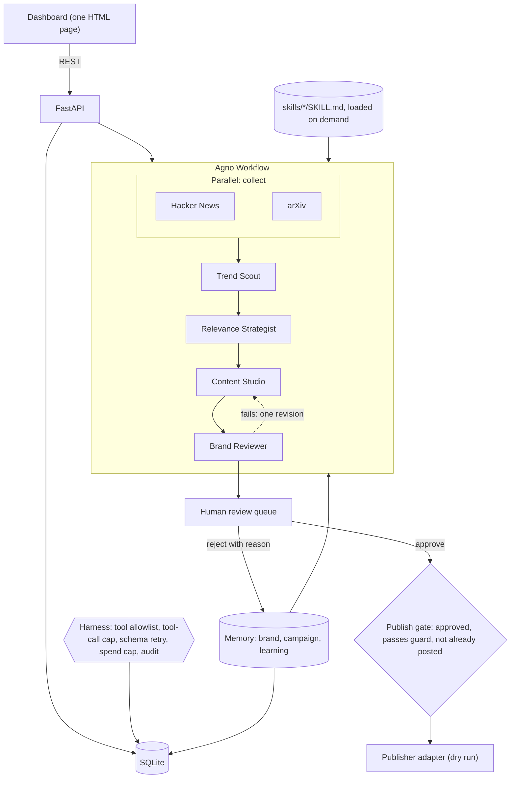

# TrendPilot AI: system design

An independent interview prototype, not affiliated with or endorsed by Dots-In. It uses only public information about the company and never connects to its models or user data.

## 1. Requirements

**Functional.** Pull live AI and behavioural-science discussions, score them against Dots-In's content pillars, draft LinkedIn and Instagram posts, review them against known brand facts, let a human edit, approve or reject, publish approved posts only, and learn from human feedback.

**Non-functional.** Every trend has a real source URL. No agent can publish. One run costs well under $1 with a hard spend cap. Every tool call and decision is auditable. Retrying a publish never double-posts. A demo works offline in mock mode.

**Constraints.** One night to build, one developer, must be fully explainable in an interview. Stack given: Agno, multi-agent orchestration, tools, memory management, harness, SKILL.md.

## 2. High-level design

**Why a Workflow and not a Team.** The order is known in advance, so code should own it. Model-driven delegation adds token cost and failure modes without adding value here. Autonomy stays inside each step, where a model genuinely has to research, judge or write.

**Why function steps wrap the agents.** Each `Step` runs a Python function that calls the agent through the harness. This puts retries, validation and spend checks in one place instead of relying on the model.

## 3. The stack, mapped

| Asked for | Where it lives | What it does |
|---|---|---|
| Agno | `app/agents.py`, `app/pipeline.py` | `Agent`, `Workflow`, `Parallel`, `Step`, `Skills`, `tool_hooks`, `output_schema` |
| Multi-agent orchestration | `app/pipeline.py` | Parallel collection, then four sequential specialists and one bounded revision loop |
| Tools | `app/agents.py`, `app/sources.py` | Live search and memory lookups, each scoped per agent |
| Memory management | `app/memory.py` | Three stores with capped, query-specific retrieval |
| Harness | `app/harness.py`, `app/publishing.py` | Permissions, limits, validation, budget, audit, approval gate |
| SKILL.md | `skills/` | Instructions loaded only when an agent asks for them |

## 4. Harness

Models propose and code enforces.

| Control | Mechanism |
|---|---|
| Tool permission | One Agno `tool_hook` checks every call against a per-agent allowlist. No agent is given a publish tool at all. |
| Runaway loops | Per-agent count in the hook: calls over the limit are denied, and a model that keeps going is stopped |
| Invalid output | Pydantic validation, one retry that feeds the error back |
| Transient failure | Bounded retry with backoff, and a model client timeout |
| Cost | Budget checked before every agent run using real provider usage |
| Invented sources | A trend must cite a URL that was actually fetched this run |
| Risky claims | Deterministic guard: platform length, banned phrases, numeric claims must appear in approved text or the source |
| Prompt injection | Fetched text is delimited as untrusted data, and the worst outcome is a bad draft that a human must still approve, since agents cannot publish |
| Human approval | Publish requires an approved row in the database, checked in code at publish time |
| Double posting | `UNIQUE(draft_id)` on posts, inserted before the adapter is called |
| Audit | Every tool call, denial, agent run and decision is a row with tokens and duration |

## 5. Memory

| Store | Holds | Read how |
|---|---|---|
| Brand | Public company statements, tone, content pillars | FTS5 search, top 3, capped by characters |
| Campaign | Past approved and published posts per pillar, plus every URL seen | Latest 3 for the pillar; seen URLs are dropped before any model call |
| Learning | Human rejection reasons, one per pillar and platform, newest wins | Latest 5, injected through a tool |

Agents pull what they need through tools instead of receiving all history, so context stays roughly flat as history grows. Rejecting a draft with a reason changes the next run's writing.

## 6. Data model (SQLite)

`runs` (status, tokens, cost) · `audit` (actor, action, target, allowed, tokens, duration) · `trends` (`source_url` unique, raw engagement, five factor scores, pillar, reason) · `drafts` (platform, body, status, review result, edited) · `approvals` (decision, reviewer, comment) · `posts` (`draft_id` unique, mode, external id, status) · `brand_knowledge` (FTS5) · `learnings` (key, value).

Draft status moves `needs_review` → `approved` or `rejected`, then `approved` → `published`.

## 7. Scoring

`Score = 0.30 Relevance + 0.25 BrandFit + 0.20 Momentum + 0.15 Evidence + 0.10 ContentPotential`

The model scores relevance, brand fit, evidence and content potential. **Momentum is computed by code** from real points, comments and age, so engagement can't be invented. Code does the weighted sum. Example: 90, 95, 80, 90, 85 gives 88.75. The weights are a starting heuristic, not a validated model.

## 8. API

| Method | Path | Purpose |
|---|---|---|
| GET | `/api/status` | Provider, model, whether a key is set, whether a run is active |
| POST | `/api/pipeline/run` | Start a run (409 if one is active) |
| GET | `/api/runs` | Runs with tokens and cost |
| GET | `/api/trends` | Scored trends |
| GET | `/api/content` | Drafts with review results |
| POST | `/api/content/{id}/edit` | Edit a draft under review |
| POST | `/api/content/{id}/approve` | Approve, re-running the guard |
| POST | `/api/content/{id}/reject` | Reject, recording the reason as a learning |
| POST | `/api/publish/{id}` | Publish through the gate |
| GET | `/api/audit` | Audit trail |
| GET | `/api/memory` | Learnings and brand entries |

## 9. Trade-offs

| Decision | Gain | Cost | Upgrade when |
|---|---|---|---|
| SQLite, not Postgres | No server, nothing to fail in a demo | One writer at a time | More than one worker or user |
| FTS5, not vectors | No embeddings, explainable | Misses synonyms | Brand corpus grows |
| Thread in the API process, not a queue | No Redis or worker | Run dies with the process | Scheduled or concurrent runs |
| Dry-run publisher | Works without LinkedIn app approval | Nothing is really posted | Credentials and page permission exist |
| One static page, not React | No build step | Harder to grow | More screens or users |
| Localhost, no login | Fast to demo | Not deployable as is | Before any deployment |

## 10. Scale and reliability, if this were real

The measured real run made 10 agent runs and 30 tool calls in about 5.5 minutes, so throughput is limited by provider latency, not local compute. To scale: move runs to a queue with idempotent steps, use Postgres, add a scheduler, put login in front of approval, and add `pgvector` if keyword retrieval starts to miss. Monitor cost per run, guard rejection rate, human approval rate and source failures. Human approval rate is the metric to tune the score weights against.
